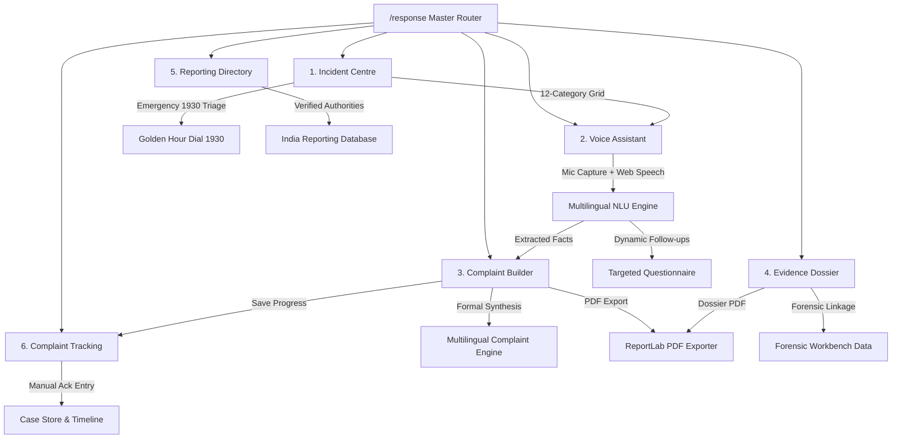

# VERISIGHT RESPONSE & GUIDANCE — ARCHITECTURE SPECIFICATION
**Module:** `VeriSight Response & Guidance`  
**Tagline:** *"From suspicious evidence to informed action."*  
**Version:** 1.0.0 (Production Extension)  
**Date:** November 2026  

---

## 1. Executive Summary & Product Vision

VeriSight has evolved beyond standalone digital evidence detection into **evidence-assisted incident response**. While the Forensic Workbench determines *whether* a payment screenshot or transaction artifact has been manipulated, **VeriSight Response & Guidance** guides victims of cybercrime and payment deception through the critical next steps:
1. **Understanding the Incident:** Interpreting what occurred without legal or technical jargon.
2. **Preserving Relevant Evidence:** Maintaining cryptographic custody (SHA-256) and unedited chat/screenshot logs.
3. **Identifying Official Pathways:** Verified Indian authorities (NCRP 1930, Bank Grievance, RBI CMS, Police, Platforms).
4. **Preparing a Formal Complaint:** Generating factual, chronological, multilingual complaint documents.
5. **Organizing Forensic Dossiers:** Exporting print-ready technical evidence packets with ELA, wavelet noise, and baseline drift metrics.
6. **Navigating Reporting Channels:** Providing portal handoff guides and prerequisite checklists.
7. **Tracking Reference Numbers:** Recording 14-digit NCRP acknowledgement numbers, bank dockets, and statutory follow-up dates.

---

## 2. Global & Contextual Navigation Architecture

The module is natively integrated into VeriSight across two first-class access points:

```
[Main Navigation Bar]
  ├── Product Overview       (/)
  ├── Forensic Workbench     (/workbench)
  ├── Evaluation & Research  (/evaluation)
  ├── Why VeriSight          (/why-verisight)
  └── Response & Guidance    (/response) [NEW PERSISTENT DESTINATION]

[Forensic Workbench Contextual Action]
  ├── Verdict Hero Card ──────> "What should I do next?" Button
  ├── Syndicate Resolution Card > "What should I do next?" Action
  └── Top Command Bar ─────────> "What Next?" Tactical Action
            │
            ▼ (Preserves Active Investigation State)
  ┌───────────────────────────────────────────────────────────────┐
  │ Context Ingested:                                             │
  │ • Case ID: VS-CASE-XXXX                                       │
  │ • File SHA-256: 48192039... (Dimensions & Metadata)           │
  │ • Tamper Risk Score & Verdict (e.g. 94.6% MANIPULATED_FORGERY)│
  │ • Multi-Layer Findings (ELA, Wavelet void, Baseline laser)    │
  │ • Cross-Layer Synergy multiplier                              │
  └───────────────────────────────────────────────────────────────┘
            │
            ▼
  Route: /response (Pre-populates Evidence Dossier & Context Banner)
```

---

## 3. Sub-Module Hierarchy & Architecture



---

## 4. Backend API Contracts & Data Models

### 4.1 Endpoints Specification

| Method | Endpoint | Description |
|---|---|---|
| `POST` | `/api/response/understand` | Ingests voice transcript/text, extracts structured entities, classifies category & financial impact, returns urgent guidance & next dynamic question. |
| `POST` | `/api/response/next-question` | Evaluates missing fields and returns next targeted question. |
| `POST` | `/api/response/generate-complaint` | Synthesizes formal chronological complaint in selected Indian language. |
| `POST` | `/api/response/regenerate-section` | Refines narrative clarity, legal tone, or urgency. |
| `POST` | `/api/response/export-complaint-pdf` | Generates downloadable formal complaint PDF via ReportLab. |
| `POST` | `/api/response/export-dossier-pdf` | Generates cryptographic forensic evidence dossier PDF. |
| `GET` | `/api/response/reporting-directory` | Returns searchable, categorized verified Indian reporting authorities. |
| `GET` | `/api/response/reporting-directory/{id}` | Returns single authority submission guide. |
| `GET` | `/api/response/cases` | Lists active tracked incident response cases. |
| `GET` | `/api/response/cases/{case_id}` | Fetches individual case details and event timeline. |
| `POST` | `/api/response/cases` | Saves or updates case status, acknowledgement number, notes, or follow-up date. |
| `POST` | `/api/response/cases/create` | Initializes a new case from extracted incident details. |

---

## 5. Privacy, Security & Responsible AI Framework

1. **Zero Unnecessary Audio Retention:** Audio is processed client-side via Web Audio API and Web Speech API. Raw audio buffers are held in memory during the session and discarded upon deletion or reset. No raw audio files are uploaded to external cloud storage.
2. **Explicit Consent & Disclosures:** The recording interface displays an active privacy banner stating: *"Audio recording runs client-side in your browser. VeriSight does not retain raw audio without explicit consent."*
3. **No Financial Credential Exposure:** VeriSight actively disclaims and warns against entering banking passwords, OTPs, ATM PINs, or card CVVs.
4. **Forensic Distinction:** All generated complaints explicitly separate:
   - Complainant's personal observations.
   - Counterparty representations.
   - Screenshot visual representations.
   - Algorithmic forensic signals.
   - Unverified elements.
5. **Clear Legal Disclaimers:** Every generated document and screen clarifies that VeriSight is an independent forensic platform and not an official police body, judicial court, or government agency.

---

## 6. Implementation Status Matrix

| Sub-System | Capability | Status |
|---|---|---|
| **Navigation** | Persistent `/response` route in main header | **Fully Implemented** |
| **Forensic Handoff** | "What should I do next?" contextual action in Risk Dossier | **Fully Implemented** |
| **Voice Interface** | HTML5 Canvas real-time audio waveform (Web Audio API) | **Fully Implemented** |
| **Voice Recording** | Start, Stop, Pause, Resume, Replay, Delete, Duration counter | **Fully Implemented** |
| **Speech Recognition** | Multilingual Web Speech API (en-IN, hi-IN, kn-IN, bn-IN, ta-IN, te-IN, mr-IN) | **Fully Implemented** |
| **NLU Engine** | Rule-based entity extraction (amounts, UTRs, VPAs, phones, banks, channels) | **Fully Implemented** |
| **Dynamic Follow-Ups** | Adaptive 1-at-a-time targeted question engine | **Fully Implemented** |
| **Incident Classification**| 12-category classification engine with financial impact triage | **Fully Implemented** |
| **Reporting Directory** | Verified Indian pathways (NCRP 1930, Banks, RBI CMS, Police, Platforms) | **Fully Implemented** |
| **Complaint Engine** | Multilingual formal complaint generator (7 Indian languages) | **Fully Implemented** |
| **Document Editor** | Interactive document editor with live preview & section refinement | **Fully Implemented** |
| **PDF Generation** | ReportLab backend PDF generator for complaints & dossiers | **Fully Implemented** |
| **Case Tracking** | Case status workflow, manual acknowledgement recording, activity timeline | **Fully Implemented** |
| **Local Whisper STT** | Fully offline ONNX speech-to-text fallback | **Planned / Experimental** |
