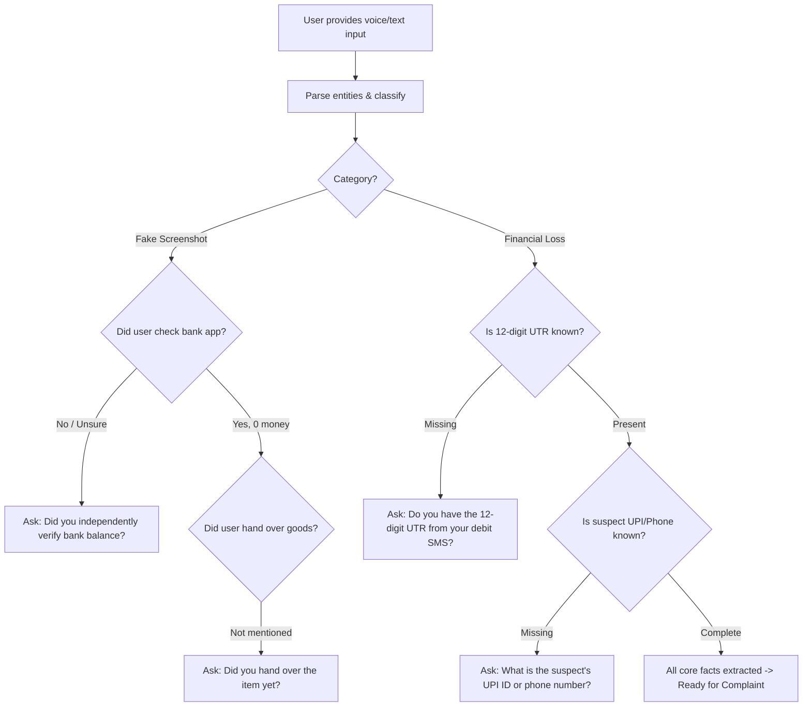

# VERISIGHT VOICE-TO-COMPLAINT INTELLIGENCE SPECIFICATION
**Technical Specification & Engine Design**  
**Module:** `app.services.response.nlu_engine` & `VoiceReportingAssistant.tsx`  
**Target Languages:** English, Hindi (हिन्दी), Kannada (ಕನ್ನಡ), Bengali (বাংলা), Tamil (தமிழ்), Telugu (తెలుగు), Marathi (मराठी)  

---

## 1. Speech Technology Evaluation & Engine Selection

To determine the most appropriate speech recognition architecture, four technical options were systematically evaluated against VeriSight's production constraints:

| Evaluation Metric | Option A: Web Speech API (In-Browser Native) | Option B: Cloud STT (Google Cloud / Azure / Whisper API) | Option C: Local Whisper ONNX (Client-side WASM) | Option D: Local Server Whisper (Python) |
|---|---|---|---|---|
| **Accuracy (Indian Accents)** | High on Chrome/Edge (Android & Windows) | Very High | Moderate to High | High (with medium model) |
| **Multilingual Coverage** | High (en-IN, hi-IN, kn-IN, bn-IN, ta-IN, te-IN, mr-IN native) | Comprehensive | Varies by quantized model size | High |
| **Streaming Latency** | **Real-Time (Zero Latency)** | Network RTT (~500ms–1.5s) | Client CPU dependent | Network RTT (~1.2s) |
| **Privacy by Design** | **Local Browser Processing (No third-party cloud audio retention)** | Cloud data transfer disclosure required | Fully Local (Device memory) | Server memory |
| **Cost & API Keys** | **Zero Cost (No API keys required)** | Paid per-minute billing | Zero Cost | Server GPU / CPU load |
| **Deployment Overhead** | **Zero Dependencies** | API Key configuration & network dependency | Heavy bundle size (75MB+ WASM) | High RAM / GPU requirements |

### Selected Architecture
**Hybrid Zero-Overhead Approach:**
1. **Primary Audio Capture:** HTML5 `navigator.mediaDevices.getUserMedia` + Web Audio API `AudioContext` and `AnalyserNode` for real-time waveform visualization.
2. **Primary Live Transcription:** Browser-native Web Speech API (`SpeechRecognition` / `webkitSpeechRecognition`) supporting regional Indian locales (`en-IN`, `hi-IN`, `kn-IN`, `bn-IN`, `ta-IN`, `te-IN`, `mr-IN`).
3. **Editable Transcription Bridge:** Live transcripts stream directly into an editable textarea, allowing users to correct regional names, specific acronyms, or misrecognized digits.
4. **Offline / Fallback Resilience:** Users in browsers without speech recognition can type or paste statements directly without degradation of NLU or complaint generation capabilities.

---

## 2. Live Waveform & Audio Visualization Architecture

The recording studio uses an HTML5 Canvas hooked into the Web Audio API rendering 32 frequency bins at 60 FPS:

```typescript
// Fast FFT configuration
const audioCtx = new (window.AudioContext || window.webkitAudioContext)();
const analyser = audioCtx.createAnalyser();
analyser.fftSize = 128; // 64 frequency bands
const source = audioCtx.createMediaStreamSource(stream);
source.connect(analyser);

// Responsive canvas rendering
const dataArray = new Uint8Array(analyser.frequencyBinCount);
// Bars rendered with vertical linear gradient from #38bdf8 to #0284c7
```

Recording controls:
- **Start Recording:** Requests microphone permission, initializes `AudioContext` and `MediaRecorder`.
- **Pause Recording:** Halts stream chunks and timer without terminating session.
- **Resume Recording:** Resumes media chunk ingestion.
- **Stop Recording:** Encapsulates captured audio as a `Blob` (`audio/webm`) and produces a local `blob:` URL for instant replay.
- **Delete / Re-record:** Cleans up buffers and releases hardware access immediately.

---

## 3. Natural Language Understanding (NLU) Pipeline

The NLU engine (`nlu_engine.py`) extracts 14 structured entity fields from raw natural language statements:

### 3.1 Entity Extraction Architecture

1. **Financial Amounts:**
   - Detects standard Indian currency notations: `₹18,000`, `18000`, `18k`, `Rs 18000`, `rupees`, `रुपये`, `रु`, `ರೂಪಾಯಿ`, `টাকা`, `பணம்`, `రూపాయలు`.
   - Pattern: `r"[₹]\s*([\d,]+(?:\.\d{1,2})?)"`, `r"(?:lost|paid|transferred|deducted|debited|of)\s+([\d,]+(?:\.\d{1,2})?)"`.
2. **12-Digit Transaction References (UTRs / RRNs):**
   - Matches Indian banking switch standard 12-digit numeric sequences: `\b(\d{12})\b`.
   - Also extracts alphanumeric references: `(?:utr|rrn|ref|reference|txn id)[:\s#]*([a-zA-Z0-9]{8,18})`.
3. **Virtual Payment Addresses (VPAs / UPI IDs):**
   - Extracts UPI handles: `\b([a-zA-Z0-9.\-_]{2,64}@[a-zA-Z]{2,32})\b`.
   - Automatically filters out standard personal email domains (`@gmail.com`, `@yahoo.com`, `@outlook.com`).
4. **Indian Mobile Numbers:**
   - Matches 10-digit Indian numbers starting with 6, 7, 8, or 9: `(?:\+91[\-\s]?)?([6-9]\d{9})\b`.
5. **Bank & Payment Service Provider (PSP) Identification:**
   - Multilingual aliases for major Indian banks and apps: Google Pay, PhonePe, Paytm, BHIM, SBI, HDFC, ICICI, Axis Bank, PNB, Kotak, Bank of Baroda.
   - Cleans VPA handles before matching to avoid attributing fraudster handles (e.g. `scammer@paytm`) to the complainant's bank.
6. **Communication Channels:**
   - Detects WhatsApp, Telegram, OLX, Instagram, Phone Call, SMS, Facebook.
7. **Incident Date & Time:**
   - Detects relative terms ("today", "yesterday", "आज", "ಇಂದು") and standard timestamps.

---

## 4. Incident Classification & Urgency Triage

### 4.1 Supported Categories
1. `FAKE_PAYMENT_SCREENSHOT`: Forged UPI / bank screenshot; zero funds received.
2. `PAYMENT_FRAUD`: General deceptive payment transfer or advance fee deception.
3. `UNAUTHORIZED_BANK_TRANSACTION`: Unauthorized debit from bank account without user consent.
4. `UPI_FRAUD`: Fraudulent collect requests, entering UPI PIN to "receive" funds.
5. `QR_CODE_FRAUD`: Misleading QR code presented as payment receiving mechanism.
6. `IMPERSONATION`: Pretending to be police, customs, defense personnel, or bank officials.
7. `IDENTITY_MISUSE`: Unauthorized use of Aadhaar, PAN, or KYC credentials.
8. `DIGITAL_PAYMENT_DISPUTE`: Transaction failed/debited with statutory reversal delay.
9. `SUSPICIOUS_TRANSACTION_EVIDENCE`: Verification of questionable receipt graphics or fonts.
10. `ONLINE_MARKETPLACE_FRAUD`: Peer-to-peer buyer/seller fraud on OLX, Quikr, Facebook Marketplace.
11. `PHISHING_SOCIAL_ENGINEERING`: Remote access app installs (AnyDesk, TeamViewer) or malicious links.
12. `OTHER_CYBERCRIME`: General cybercrime incidents.

### 4.2 Financial Impact Differentiation
- `MONEY_LOST`: Funds have left victim's account. Immediate 1930 Golden Hour guidance triggered.
- `NO_MONEY_LOST`: Deceptive receipt received but goods/funds preserved. Guidance focuses on evidence preservation and merchant protection.
- `RECEIVED_BUT_DISPUTED`: Money credited then placed on hold or disputed via chargeback.
- `TRANSACTION_PENDING`: Transaction pending at bank gateway.
- `UNAUTHORIZED_DEBIT`: Automated debit without OTP.
- `UNCERTAIN`: User statement does not confirm financial debit status.

---

## 5. Dynamic Contextual Follow-Up Questioning

Rather than presenting an intimidating 20-field form, VeriSight asks **one targeted question at a time**:



---

## 6. Formal Complaint Synthesis & Multilingual Templates

The complaint generator produces a formal legal-evidentiary statement structured into distinct evidentiary layers:

1. **Title & Reference:** Official document identifier (e.g. `VS-CMP-A1B2C3D4`).
2. **Jurisdictional Destination:** Addressed to NCRP / Cyber Cell / Bank Nodal Officer.
3. **Complainant Information:** Name, verified phone, address.
4. **Statements Breakdown:**
   - *Complainant Experience:* What the victim personally observed.
   - *Counterparty Claims:* What the suspect claimed.
   - *Screenshot Representation:* Visual elements shown in disputed screenshot.
   - *Forensic Observations:* VeriSight multi-spectral signals (SHA-256, baseline laser, ELA).
   - *Unverified Elements:* Items requiring statutory subpoena under Section 91 CrPC.
5. **Relief & Investigation Requested:**
   - Freezing suspect beneficiary accounts under Section 106 BNSS / Section 102 CrPC.
   - Preservation of telecom and platform logs under Section 94 BNSS / Section 91 CrPC.
6. **Annexure Inventory:** List of attached screenshots, bank statements, and VeriSight forensic reports.
7. **Legal Disclaimer:** Clarifies that the technical summary assists evidence presentation and does not constitute a judicial conclusion.
