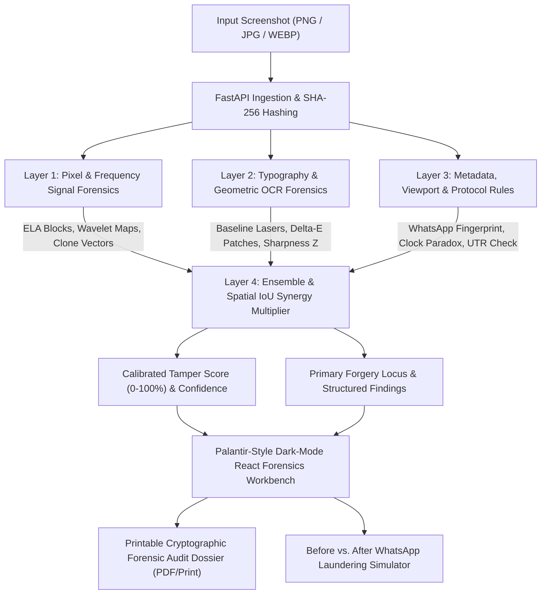

# VeriSight — System Architecture Specification
**HackStellar 2026 — Problem Statement 12: "Is This Screenshot Real?"**

---

## 1. Architectural Philosophy: Why Vision LLMs Fail & Why Deterministic Multi-Layer Forensics Succeed

Vision Large Language Models (VLMs) operate in a semantic latent space optimized for natural language description. Consequently, VLMs suffer from critical blind spots when evaluating digital screenshots:
1. **Sub-Pixel Spatial Resolution Loss:** Tokenized vision transformers downscale images into coarse patches ($14 \times 14$ or $16 \times 16$ pixels), obscuring $1\text{–}3\text{ px}$ typographic baseline drifts, character kerning shifts, and font anti-aliasing irregularities.
2. **Frequency Domain Invisibility:** Subtle JPEG double-compression artifacts, DCT quantization mismatches, and high-pass wavelet noise drops cannot be detected by visual inspection of decoded RGB pixels alone.
3. **Hallucination of Plausible Layouts:** If a fake payment generator crafts a plausible-looking receipt with a fabricated amount, a VLM will confirm that the layout looks "standard" without mathematically verifying status-bar clock temporal consistency or background patch color distance ($\Delta E_{ab}$).

**VeriSight** solves this with a **4-Layer Deterministic Forensic Pipeline**:
- **Layer 1 (Signal & Frequency):** Measures physical pixel and frequency domain residuals.
- **Layer 2 (Typography & Geometry):** Measures sub-pixel font rasterization, baselines, and local background patches.
- **Layer 3 (Metadata & Domain Rules):** Inspects container chunks, WhatsApp media laundering, mobile viewport geometry, and domain protocol paradoxes.
- **Layer 4 (Ensemble & Spatial IoU Synergy):** Combines evidence using spatial cross-correlation and Bayesian calibrated scoring.



---

## 2. Component Architecture

### 2.1 Backend (`verisight/backend/`)
The backend is built as a high-performance, asynchronous FastAPI service:
- **`app/main.py`:** Application lifespan, CORS middleware, static sample mount, and REST router mounting.
- **`app/api/endpoints.py`:**
  - `GET /api/health` — Service readiness and dependency health checks.
  - `GET /api/demo-samples` — Lists the 5 pre-generated golden demonstration screenshots with ground-truth scenarios.
  - `POST /api/analyze` — Multipart file upload triggering full 4-layer forensic investigation.
  - `POST /api/analyze-sample` — Instant 1-click execution against any golden demonstration sample.
  - `POST /api/simulate-whatsapp` — Simulates WhatsApp media delivery pipeline (EXIF stripping, resizing to max 1600px, 4:2:0 subsampling, JPEG Q=77) and returns side-by-side comparison telemetry.
  - `POST /api/mobile-upload` — Mobile file upload route accessed by stage judges scanning the QR code.
  - `GET /api/latest-mobile-upload` — Long-poll / fetch endpoint allowing the desktop workbench to pop up phone uploads live.
  - `GET /api/network-info` — Auto-detects the host machine's local LAN IP address (`192.168.x.x`) to construct the mobile QR upload URL.
- **`app/core/schemas.py`:** Strict Pydantic v2 data models for bounding boxes, baseline lasers, layer results, findings, and full analysis reports.
- **`app/services/forensic/`:**
  - `pixel_analysis/`: Multi-scale ELA, Daubechies db4 wavelet noise variance, ORB copy-move translation vector clustering, and JPEG ghost analysis.
  - `typography/`: Dual-engine text extractor (EasyOCR with fast OpenCV Morphological Gradient + Connected-Components fallback), Horizontal baseline laser regression, and CIELAB $\Delta E_{ab}$ perceptual card patch detector.
  - `metadata/`: Container chunk parser (EXIF/PNG/ICC), WhatsApp media fingerprinter, viewport aspect ratio database, status-bar clock temporal paradox validator, and 12-digit UPI UTR validator.
  - `provenance/`: C2PA Content Credentials reader & trust state evaluator.
  - `adapters/`: Clean optional adapter for learned deep models (TruFor / Noiseprint).
  - `ensemble/`: Bayesian score calibrator and spatial IoU cross-layer synergy multiplier.
  - `simulation/`: WhatsApp recompression and resizing pipeline simulator.

### 2.2 Frontend (`verisight/frontend/`)
The frontend is a Palantir/Sherloq-inspired dark-mode intelligence workbench built with React, Vite, Tailwind CSS, Lucide Icons, and Framer Motion:
- **Canvas Color Palette:**
  - Background Canvas: `#070b14` (Deep void black)
  - Panels & Cards: `#0f172a` / `#0c1322` (Slate/Navy)
  - Aligned Typography Lasers: `#38bdf8` (Electric Cyan)
  - Critical Tamper Alerts: `#f43f5e` (Crimson / Rose)
  - Authentic Verified Badges: `#10b981` (Emerald Green)
- **Interactive Multi-Spectral Canvas (`ForensicViewer.tsx`):**
  - View modes: Original Image, ELA Heatmap, Wavelet Noise Map, Copy-Move Clone Vectors, Split Comparison, and Quad-Grid Matrix.
  - Interactive SVG Overlays: Crisp horizontal baseline laser lines with pixel-drift callout badges (+3.5px DRIFT | ΔE=5.2) and anomaly bounding box reticles.
  - 3x Synchronized Forensic Loupe: Moving the cursor over the image displays a floating dual Picture-in-Picture magnifying glass showing 3x zoomed Original Pixels side-by-side with 3x zoomed ELA/Wavelet pixels at that exact coordinate.
- **Evidence Dossier Sidebar (`RiskDossierSidebar.tsx`):**
  - Animated Radial Tamper Gauge ($0\text{–}100\%$), Confidence %, and Detected Channel Pill (e.g., Native Capture vs. WhatsApp Re-Compressed).
  - 4-Layer Telemetry Progress Bars with expandable mathematical measurement tables.
  - Clickable Findings Feed: Clicking any anomaly highlights and pulses the exact bounding box on the central canvas.
- **Top Command & Demo Bar (`TopCommandBar.tsx`):**
  - 1-Click Golden Sample Pills (Samples 1–5).
  - Simulate WhatsApp Forward Button with before/after comparison modal.
  - Live Judge Mobile Upload QR Button.
  - Export Printable Forensic Certificate Button.
- **Mobile Upload Route (`MobileUploadView.tsx`):**
  - Triggered automatically via `?mode=mobile`. Clean, high-contrast mobile upload interface for stage judges.

---

## 3. Data Contracts & Bounding Box Specification

Every anomaly detected across all 4 layers conforms to the unified coordinate schema:
```typescript
interface BoundingBox {
  x: number;          // Left offset in original image pixels
  y: number;          // Top offset in original image pixels
  width: number;      // Bounding box width
  height: number;     // Bounding box height
  label: string;      // Human-readable title (e.g. "Spliced Amount Patch")
  confidence: number; // 0.0 to 1.0
  layer: number;      // 1, 2, 3, or 4
  anomaly_type: string; // e.g. "ELA_MACROBLOCK_OUTLIER", "SUBPIXEL_BASELINE_DRIFT"
  details?: Record<string, any>;
}
```

---

## 4. Cross-Layer Spatial IoU Synergy Mechanism

When an image is manipulated, attackers typically alter specific semantic fields (such as the monetary amount, sender UPI ID, or timestamp). 
If Layer 1 (Signal) flags an ELA macroblock or wavelet noise void at coordinate box $B_1$, and Layer 2 (Typography) independently flags a baseline drift or background patch discontinuity at coordinate box $B_2$:
$$\text{IoU}(B_1, B_2) = \frac{\text{Area}(B_1 \cap B_2)}{\text{Area}(B_1 \cup B_2)}$$
If $\text{IoU} > 0.20$ or the Euclidean distance between their bounding box centroids $d(C_1, C_2) \le 15\text{ px}$:
1. A **$1.35\times$ Cross-Layer Synergy Multiplier** is applied to the composite risk score.
2. The intersection region is isolated and designated as the **Primary Forgery Locus**.
3. Correlated findings are reported transparently in the audit dossier.

---

*Architecture approved for implementation.*
