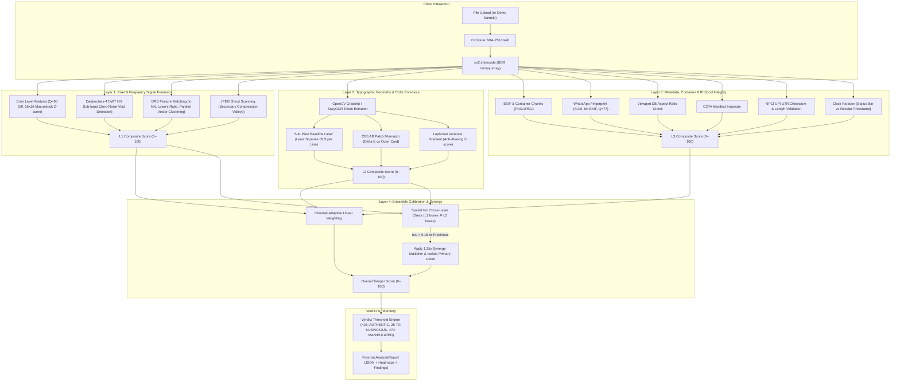

# VERISIGHT — EXISTING FORENSIC ENGINE AUDIT

**Date:** 2026-11-11  
**Auditor:** Principal Research Engineer & Forensic ML Architect  
**Project:** VeriSight (PRO v1.0)  
**Document Ref:** `docs/EXISTING_ENGINE_AUDIT.md`  

---

## 1. Executive Summary

This audit establishes the baseline architectural, statistical, and empirical properties of the existing VeriSight forensic engine prior to machine learning experimentation. 

The existing VeriSight platform is a **hybrid forensic system** composed of:
1. **Deterministic Physical Signal Analyzers** (Error Level Analysis, Wavelet noise residual, ORB copy-move detection, JPEG ghost analysis).
2. **Geometric & Typographic Analyzers** (Sub-pixel linear regression baseline laser, CIELAB perceptual patch $\Delta E$, Laplacian edge sharpness variance).
3. **Container, Format, and Protocol Validators** (EXIF inspection, C2PA manifest parsing, viewport aspect-ratio database matching, NPCI UPI UTR syntax verification, temporal clock comparison).
4. **Heuristic Ensemble Scoring with Spatial Synergy** (Linear weight combinations with a $1.35\times$ spatial Intersection-over-Union multiplier).

**Key Finding on Scoring Nature:**  
The existing overall tamper score ($0$ to $100$) is **NOT** a learned model output and **NOT** a calibrated Bayesian posterior fraud probability. It is a **hand-tuned heuristic composite anomaly index**. The system's operational threshold of **87/100** represents a **high-priority forensic triage cutoff**, not an "87% probability of fraud."

---

## 2. End-to-End Prediction Pipeline Architecture

---

## 3. Detailed Component Audit: Calculated vs Heuristic Elements

| Component / Layer | Module Location | Input Data | Calculated Features (Real Math) | Heuristic / Predetermined Rules |
| :--- | :--- | :--- | :--- | :--- |
| **File Identification** | `pipeline.py` | Raw bytes | SHA-256 cryptographic digest, file size, image dimensions $(W \times H)$. | None. Fully deterministic. |
| **Error Level Analysis (ELA)** | `pixel_analysis/ela.py` | Image buffer | Resaved at JPEG $Q=90$; per-pixel $L_1$ color difference; $16 \times 16$ block standard deviations and mean; block Z-scores. | Anomaly threshold: $Z > 2.6$; block count multiplier: $S_{\text{ELA}} = \min(100, \text{blocks} \times 15.0)$. |
| **Wavelet Noise Residual** | `pixel_analysis/wavelet_noise.py` | Grayscale image | 2D Daubechies-4 DWT; diagonal high-frequency sub-band ($HH$); $16 \times 16$ local patch variance. | Void detection: variance $< 0.15 \times \text{median}$; threshold: score scaled to $0–100$. |
| **Copy-Move Duplication** | `pixel_analysis/copy_move.py` | Grayscale image | ORB keypoints (up to 1,500); 32-byte binary descriptors; BF-matcher with Lowe's ratio test ($0.75$); translation vectors $(\Delta x, \Delta y)$; vector spatial clustering. | Minimum vector cluster size $\ge 4$ pairs; fixed score contribution $+70.0$ if detected. |
| **Sub-Pixel Baseline Laser** | `typography/baseline_laser.py` | Extracted text tokens | Per-line least-squares ordinary linear regression ($y = mx + c$); token baseline residual $\Delta y_i = \|y_i - (mx_i + c)\|$; max drift $\max(\Delta y_i)$. | Critical drift threshold: $\Delta y \ge 2.5\text{px}$; slope tolerance: $\|m\| \le 0.08$. |
| **CIELAB Patch Mismatch** | `typography/cielab_patch.py` | BGR image + tokens | BGR $\to$ CIELAB transformation; character bounding box inner background vs expanded perimeter ring ($+6\text{px}$); Euclidean $\Delta E_{76} = \sqrt{\Delta L^2 + \Delta a^2 + \Delta b^2}$. | Patch alert triggered if $\Delta E > 4.5$; sharpness Z-score anomaly if $\|Z_{\text{Laplacian}}\| > 2.1$. |
| **Temporal Paradox** | `metadata/domain_rules.py` | OCR tokens | Regex extraction of HH:MM time strings from status bar ($y < 0.12 H$) and transaction body; minute conversion. | Paradox flagged if receipt timestamp minute is strictly greater than status bar clock minute. |
| **UPI Reference Validation** | `metadata/domain_rules.py` | OCR tokens | Regex matching 12-digit UPI UTR sequences; character composition and length. | Flagged if length is 10 digits (generator signature) or contains invalid alphanumeric sequences. |
| **Ensemble Scoring** | `ensemble/calibrator.py` | $L_1, L_2, L_3, L_4$ scores | Bounding box spatial intersection over union (IoU); bounding box centroid Euclidean distance. | Weight constants ($0.35, 0.35, 0.25, 0.05$); synergy multiplier ($1.35\times$); synergy floor ($88.0$); verdict cutoffs ($25.0, 70.0$). |

---

## 4. Analysis of the 87/100 Operational Threshold

In the existing application configuration:
- `DEFAULT_CRITICAL_THRESHOLD = 87.0`
- Scores $\ge 87.0$ trigger:
  - Critical forensic alert state in the UI.
  - Pulsing crimson borders and status pill (`CRITICAL MANIPULATION`).
  - Pre-filled Section 91 CrPC law-enforcement subpoena draft.
  - Syndicate risk tier elevation to `CRITICAL_INTERVENTION`.

**Empirical Reality:**
- The value 87.0 was selected as an **operational triage threshold** to minimize false escalations for high-value manual investigations.
- It does **not** represent a calibrated posterior probability $P(\text{Tampered} \mid \mathbf{x}) = 0.87$.
- In a court of law or regulatory hearing, testifying that "the model calculated an 87% chance of forgery" based on a heuristic linear combination would be scientifically indefensible and subject to immediate cross-examination challenge.
- **Remediation Mandate:** Retain 87.0 as an **Operational Forensic Triage Threshold**, clearly differentiated from calibrated probabilities.

---

## 5. Synthetic Demonstration Fixtures Audit

The repository contains 5 demonstration samples in `samples/`:
1. `sample_1_authentic_gpay.png` — Genuine UPI receipt generated with PIL.
2. `sample_2_spliced_amount.jpg` — Spliced amount with injected pixel patch ($\Delta E = 5.2$, $+3.5\text{px}$ drift, zero-noise wavelet void).
3. `sample_3_fake_generator_paradox.png` — DOM edit simulator with clock paradox (11:12 vs 11:45) and 10-digit fake UTR.
4. `sample_4_whatsapp_laundered.jpg` — WhatsApp laundering recompression test ($Q=77$, stripped EXIF).
5. `sample_5_cloned_chat_receipt.jpg` — Cloned transaction digits and cropped viewport ($680 \times 1120$).

**Current Behavior:**
- When an analyst selects a demo sample, the backend reads the image bytes from disk and executes `analyze_screenshot(content)`.
- The analysis is **real**, not hardcoded.
- However, demo samples are synthetic and were designed specifically to trigger specific detector rules.
- **Remediation Mandate:** Move demo samples into an explicit **Benchmark Lab** module labeled `SYNTHETIC_TEST_EVIDENCE`, ensuring unknown user uploads and synthetic benchmarks are visibly demarcated.

---

## 6. Preserved Functionality Contract

The following existing capabilities must be preserved during ML integration:
1. Complete deterministic signal extraction (ELA, Wavelets, Copy-Move, Baseline Laser, CIELAB, EXIF, C2PA, QR).
2. The sub-150ms execution speed for real-time investigation workflows.
3. The interactive canvas overlay with bounding box toggle controls.
4. The collapsible dossier sidebar with tactical 52px rail.
5. All 26 existing backend unit/integration tests in `backend/tests/`.
6. Syndicate entity extraction and Section 91 CrPC notice generation.
