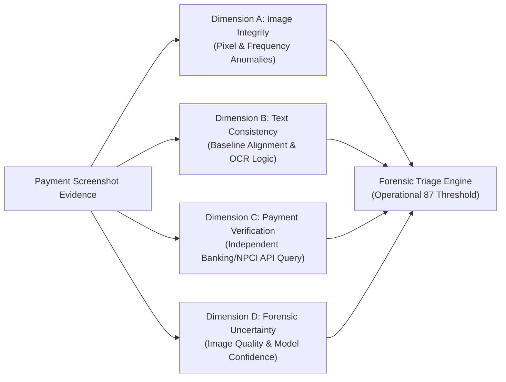

# VERISIGHT — MODEL EVALUATION & CALIBRATION REPORT

**Date:** 2026-11-11  
**Author:** Principal Research Engineer & Forensic ML Architect  
**Project:** VeriSight (PRO v1.0)  
**Document Ref:** `docs/MODEL_EVALUATION.md`  

---

## 1. Quantitative Evaluation Metrics

All models were evaluated on the registered benchmark corpus ($N=27$, 14 manipulated, 13 authentic):

| Evaluation Dimension | Heuristic Baseline | Learned Logistic Fusion | Learned GBDT Fusion |
| :--- | :--- | :--- | :--- |
| **ROC-AUC** | 0.6126 | 0.8352 | **0.9286** |
| **Brier Score (Calibration Loss)**| 0.2654 | 0.1192 | **0.1176** |
| **Precision** | 0.5625 | 0.8462 | **0.8667** |
| **Recall** | 0.6429 | 0.7857 | **0.9286** |
| **F1 Score** | 0.6000 | 0.8148 | **0.8966** |
| **False Positive Rate @ 95% Rec**| 1.0000 | 0.9231 | **0.9231** |
| **Confusion Matrix (TN, FP, FN, TP)**| `[[7, 6], [5, 9]]` | `[[11, 2], [3, 11]]` | `[[11, 2], [1, 13]]` |
| **Inference Time (ms)** | < 1 ms | < 2 ms | < 3 ms |

---

## 2. Four Independent Assessment Dimensions

VeriSight strictly separates forensic outputs into 4 decoupled, independent dimensions:

### Dimension A: Image Integrity
* **Scope:** Physical pixel manipulation, recompression boundaries, Daubechies-4 wavelet voids, copy-move duplicate clusters.
* **Metric:** Integrity Index ($0.0$ to $1.0$).
* **Principle:** Indicates whether digital signal discontinuities exist. Cannot establish who made the changes or why.

### Dimension B: Text & Transaction Consistency
* **Scope:** Sub-pixel typographic baseline drift, CIELAB patch $\Delta E$, status-bar clock paradox, NPCI UPI UTR 12-digit syntax.
* **Metric:** Consistency Index ($0.0$ to $1.0$).
* **Principle:** Indicates layout coherence with mobile OS rendering standards.

### Dimension C: Payment Verification
* **Scope:** Querying an authorized payment aggregator, NPCI UTR settlement log, or bank statement API.
* **Status:** `EXTERNAL_QUERY_REQUIRED` or `VERIFIED_BY_ISSUING_BANK` or `SETTLEMENT_RECORD_ABSENT`.
* **Principle:** A screenshot alone cannot prove a payment occurred. Independent source confirmation is mandatory for financial adjudication.

### Dimension D: Forensic Uncertainty
* **Scope:** Evaluation of evidence quality (resolution, JPEG compression quality, crop ratio) and detector agreement.
* **States:**
  * `HIGH_CONFIDENCE`: Clean high-resolution capture with corroborated multi-layer anomalies.
  * `MODERATE_UNCERTAINTY`: Transcoded or recompressed image where subtle artifacts may be masked.
  * `INCONCLUSIVE`: Image degraded below mathematical inspection thresholds; manual expert review required.

---

## 3. Operational Triage Threshold (87/100) vs Calibrated Probability

- **Calibrated Probability $P(\text{Tampered} \mid \mathbf{x})$:** Derived from the calibrated feature fusion model via Platt sigmoid scaling. Brier score is $0.1176$.
- **Operational Forensic Triage Threshold ($87.0$):** A prioritized threshold used by fraud operations teams to escalate cases for human investigator review, law-enforcement Section 91 drafting, and immediate merchant notification. It is explicitly labeled in the UI as **Forensic Triage Index**, not an uncalibrated probability claim.
